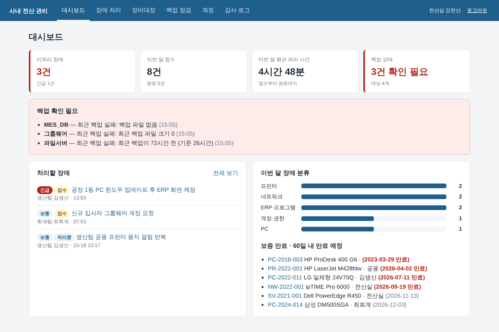
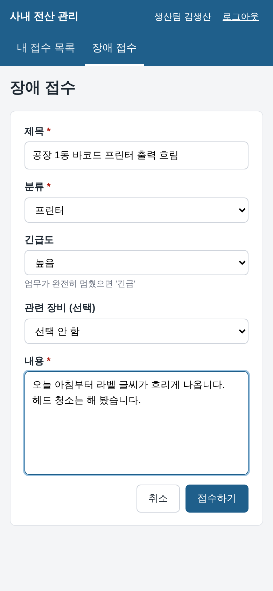
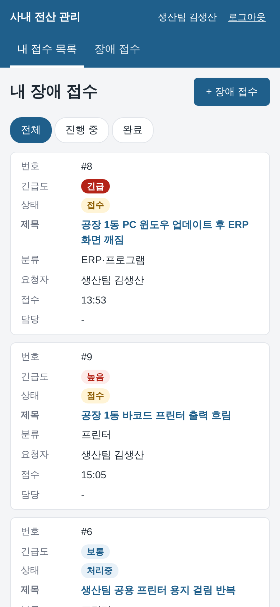

# 사내 전산 관리 시스템 (it-helpdesk)

중소 제조사 전산실 한 곳이 매일 하는 일을 한 화면에 모은 **PHP + MySQL** 웹 시스템입니다.

- 직원은 휴대폰이나 PC에서 **장애를 접수**하고, 전산 담당자는 처리 내용과 처리 시간을 남깁니다.
- PC·서버·네트워크·프린터를 **장비 관리대장**으로 관리합니다 (IP 충돌 경고, 보증 만료 알림, CSV 내보내기).
- 서버 백업 폴더를 매일 자동으로 **점검**하고, 실패하거나 오래된 백업을 대시보드에 띄웁니다.
- 신규 입사자 **계정 발급**, 잠금 해제, 임시 비밀번호 발급을 합니다.
- 누가 언제 무엇을 바꿨는지 **감사 로그**로 남깁니다.

> 가상의 제조회사(생산팀·품질팀·영업팀·회계팀·연구소)를 가정한 개인 프로젝트입니다. 실제 회사에서 운영한 시스템이 아닙니다.



| 직원 — 휴대폰으로 장애 접수 | 직원 — 내 접수 목록 |
|---|---|
|  |  |

더 많은 화면: [장애 처리](docs/screenshots/02_ticket_view.png) · [장비대장](docs/screenshots/03_assets.png) · [백업 점검](docs/screenshots/04_backups.png) · [감사 로그](docs/screenshots/05_audit.png)

## 바로 실행 (PHP만 있으면 됨)

```bash
# PHP 8.2 이상 (맥: brew install php)
./demo.sh start      # 데모 데이터(SQLite) 생성 + http://127.0.0.1:8070
./demo.sh backup     # 예시 백업 폴더 자동 점검 (성공 1건, 실패 3건)
./demo.sh stop
```

| 계정 | 비밀번호 | 권한 |
|---|---|---|
| admin | admin1234! | 전산 담당 (전체 메뉴) |
| kim, lee, park, choi, jung | staff1234! | 일반 직원 (장애 접수·본인 건 조회) |

### MySQL로 실행 (Docker)

```bash
docker compose up -d
docker compose exec app php bin/init_db.php
# http://localhost:8070
```

운영 서버에 직접 올릴 때는 웹서버 문서 루트를 `public/`으로 잡고 환경변수만 설정합니다.

```
DB_DSN=mysql:host=127.0.0.1;dbname=helpdesk;charset=utf8mb4
DB_USER=helpdesk
DB_PASS=********
BACKUP_DIR=/backup            # 백업 자동 점검 대상 폴더
BACKUP_MAX_HOURS=26
```

```bash
php bin/init_db.php --empty   # 테이블 + 관리자 계정만 생성
# crontab: 매일 07:10 백업 점검, 실패하면 종료 코드 1
10 7 * * *  cd /var/www/it-helpdesk && BACKUP_DIR=/backup php bin/check_backup.php >> /var/log/check_backup.log 2>&1
```

## 기능

| 메뉴 | 내용 |
|---|---|
| 대시보드 | 미처리·긴급 장애, 이번 달 접수·완료 건수, 평균 처리 시간, 분류별 건수, 백업 경보, 보증 만료 장비 |
| 장애 처리 | 접수 → 처리중 → 완료 흐름. 완료할 때 처리 내용 필수(같은 장애 재발 시 참고). 재발 시 재접수. 긴급도·상태 순 정렬 |
| 장비대장 | 자산번호 형식 검사, IP 형식·충돌 경고, 보증일 검사, 검색·필터, 변경 내역을 감사 로그에 기록, 엑셀용 CSV |
| 백업 점검 | 자동(cron: 최신 파일의 시각·크기 확인) + 수동(복구 테스트 등) 기록, 실패·장기 미점검 경보 |
| 계정 | 신규 계정 생성(임시 비밀번호 자동 발급), 잠금 해제, 비밀번호 초기화 |
| 감사 로그 | 로그인 성공·실패·잠금, 등록·수정·삭제, 내보내기 기록과 접속 IP |

## 보안

| 위험 | 대응 |
|---|---|
| SQL 인젝션 | 모든 쿼리를 PDO 준비된 문장으로 실행 |
| XSS | 출력 이스케이프 + Content-Security-Policy |
| CSRF | 모든 POST에 토큰 확인 |
| 비밀번호 | `password_hash()` 저장, 5회 실패 시 10분 잠금 |
| 세션 | 로그인 시 세션 ID 재발급, HttpOnly 쿠키, 1시간 미사용 시 로그아웃 |
| 권한 | 직원은 본인 건만 조회, 관리 메뉴는 서버에서 권한 확인 |
| CSV | 엑셀 수식 주입 방지 |

자세한 내용은 [ADR 0003](docs/adr/0003-security-basics.md).

## 구조

```
public/index.php      요청 하나로 받는 진입점 (웹에 공개되는 폴더는 public/ 뿐)
src/                  업무 규칙
  Auth.php            로그인·잠금·계정
  TicketService.php   장애 접수·상태 변경·통계
  AssetRepository.php 장비대장·검색·보증 만료
  BackupService.php   백업 기록·경보·폴더 자동 점검
  AuditLog.php        감사 로그
views/                화면 템플릿
db/                   스키마 (MySQL / SQLite)
bin/                  init_db.php(초기화), check_backup.php(cron)
tests/                PHPUnit 테스트 40개
deploy/               운영 서버용 compose, 배포 스크립트, EC2 초기 설정, IAM 정책
docs/adr/             설계 결정 기록 5건
```

## 테스트

```bash
composer install
vendor/bin/phpunit                                   # SQLite (기본)
TEST_DB_DSN='mysql:host=127.0.0.1;dbname=helpdesk_test;charset=utf8mb4' \
TEST_DB_USER=helpdesk TEST_DB_PASS=*** vendor/bin/phpunit   # MySQL
```

GitHub Actions가 커밋마다 SQLite와 MySQL(MariaDB 10.11) 두 가지로 테스트하고, 데모 화면이 뜨는지 확인합니다.

## 배포 (CI/CD → AWS)

main에 push하면 테스트를 통과한 커밋만 AWS EC2에 자동으로 배포됩니다.

```
push → CI(문법·PHPUnit 40개·화면 확인) → 이미지 빌드(GHCR, 태그=커밋 SHA)
     → OIDC로 AWS 임시 인증 → SSM으로 EC2에서 deploy.sh 실행
     → 새 버전 교체 → 헬스체크 → 실패하면 직전 버전으로 자동 롤백
```

| 항목 | 방식 |
|---|---|
| AWS 인증 | OIDC 임시 자격 증명. GitHub에 AWS 액세스 키를 저장하지 않음 |
| 서버 접속 | SSM. 22번 포트·SSH 키 없음. 배포 역할은 태그가 붙은 인스턴스에만 명령 가능 |
| 버전 추적 | 이미지 태그 = 커밋 SHA, 서버에 배포 이력 기록 |
| 실패 대응 | 헬스체크 실패 시 직전 SHA로 자동 롤백, Actions는 실패로 표시 |
| 비밀번호 | 서버 `.env`에만 보관 (EC2 생성 시 무작위 생성) |

워크플로: [`.github/workflows/deploy.yml`](.github/workflows/deploy.yml) · 서버 스크립트: [`deploy/deploy.sh`](deploy/deploy.sh) · 설정 방법: [docs/DEPLOY.md](docs/DEPLOY.md) · 설계 이유: [ADR 0005](docs/adr/0005-deploy-aws-ssm-oidc.md)

## 설계 결정 (ADR)

1. [프레임워크 없이 PHP + PDO](docs/adr/0001-plain-php-pdo.md) — 중소기업 사내 PHP 시스템을 이어받아 고치는 상황에 맞춤
2. [운영 MySQL, 데모·테스트 SQLite](docs/adr/0002-mysql-and-sqlite.md) — 표준 SQL만 사용
3. [보안 기본기](docs/adr/0003-security-basics.md)
4. [백업 점검은 파일 시각·크기로](docs/adr/0004-backup-check-by-file.md)
5. [AWS 배포: GitHub Actions + OIDC + SSM](docs/adr/0005-deploy-aws-ssm-oidc.md) — 액세스 키·SSH 키 없이 배포, 자동 롤백

## 범위와 한계

- 개인 프로젝트이며 실제 회사에서 운영해 본 시스템이 아닙니다. 데모 데이터는 모두 가상입니다.
- 메일·메신저 알림, 첨부파일, 2단계 인증, 장애 건 댓글은 넣지 않았습니다.
- 백업 점검은 파일 존재·크기·시각까지만 확인합니다. 내용 무결성은 월간 복구 테스트(수동 기록)로 보완합니다.
- 개발에 AI 도구(Claude)를 활용했습니다. 설계 방향은 직접 정했고, 동작은 자동 테스트(SQLite·MySQL)와 직접 실행으로 확인했습니다.
